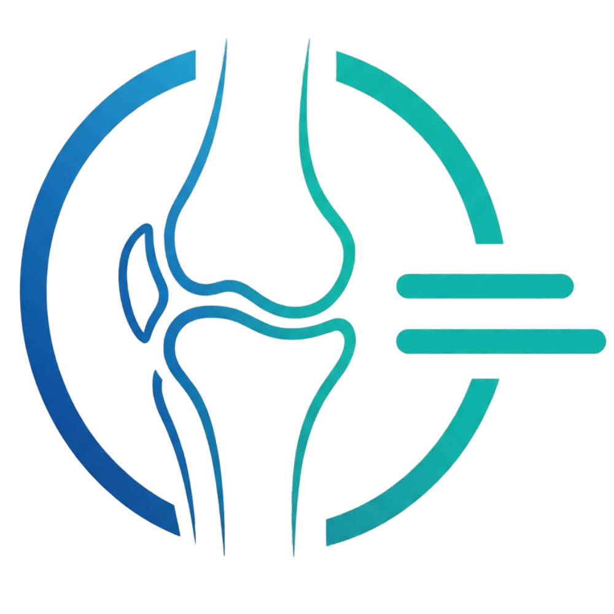
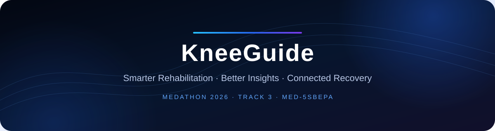
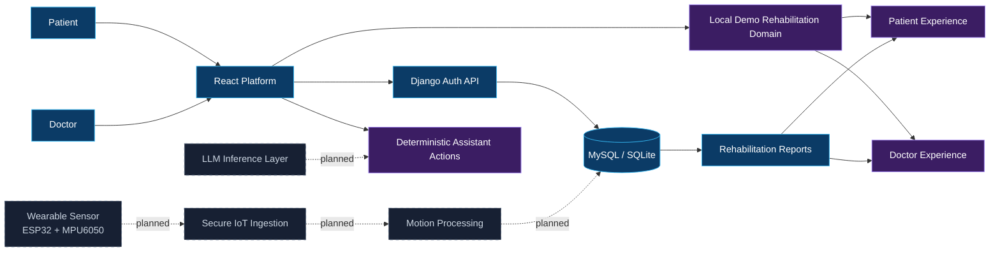
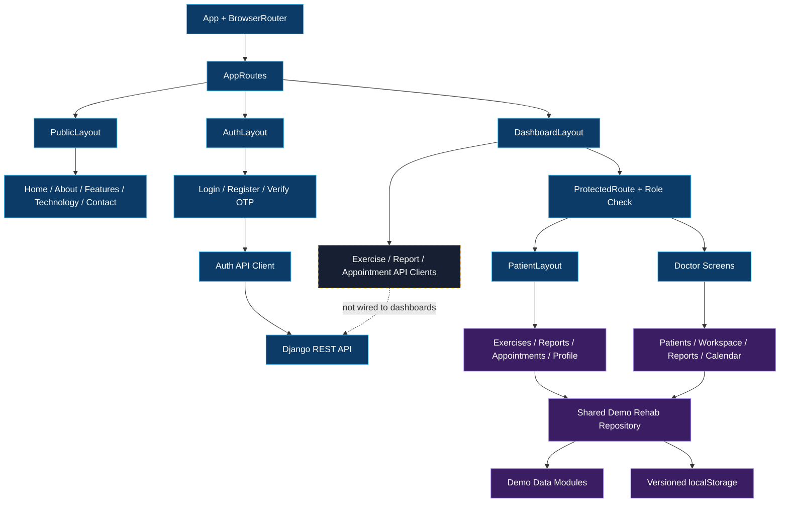
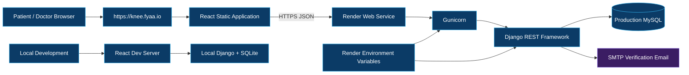
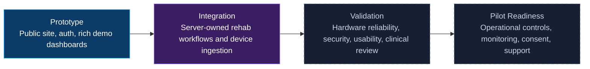

<div align="center">
  
  <h1>KneeGuide</h1>
  <p><strong>Smarter Rehabilitation. Better Insights. Connected Recovery.</strong></p>
  <p>An AI-assisted smart knee rehabilitation experience for patients and healthcare professionals.</p>

  <p>
    <a href="#current-development-status"></a>
    <a href="#team-and-credits"></a>
    <a href="#team-and-credits"></a>
    <a href="#technology-stack"></a>
  </p>
  <p>
    <a href="https://knee.fyaa.io/">Live Platform</a> ·
    <a href="https://kneeguide-backend.onrender.com/">Backend API</a> ·
    <a href="https://github.com/KneeGuide-Team/kneeguide-backend">Backend Repository</a> ·
    <a href="https://fyaa.io/">Developer Portfolio</a>
  </p>
</div>

<br />



> [!IMPORTANT]
> KneeGuide is a medical-technology prototype. It supports rehabilitation monitoring and clinician decision-making; it does not diagnose, prescribe treatment, replace clinical assessment, or claim validated clinical outcomes.

## Contents

- [The Problem](#the-problem)
- [Our Solution](#our-solution)
- [Platform Overview](#platform-overview)
- [Patient Dashboard](#patient-dashboard)
- [Doctor Dashboard](#doctor-dashboard)
- [AI Assistant](#ai-assistant)
- [Mock Data and Demonstration Environment](#mock-data-and-demonstration-environment)
- [Current Development Status](#current-development-status)
- [Technology Stack](#technology-stack)
- [Frontend Architecture](#frontend-architecture)
- [Project Structure](#project-structure)
- [Authentication and Routing](#authentication-and-routing)
- [API Integration](#api-integration)
- [IoT Integration](#iot-integration)
- [Visual Showcase](#visual-showcase)
- [Local Development](#local-development)
- [Environment Configuration](#environment-configuration)
- [Build and Deployment](#build-and-deployment)
- [Roadmap](#roadmap)
- [Known Limitations](#known-limitations)
- [Team and Credits](#team-and-credits)

## The Problem

Knee rehabilitation is often observed through periodic appointments and patient-reported progress. Between visits, clinicians may have limited visibility into exercise adherence, range-of-motion trends, pain reports, and changes in recovery behavior. Patients, meanwhile, can struggle to understand what to do next or how their daily activity contributes to a longer rehabilitation plan.

KneeGuide explores a connected workflow where structured rehabilitation records and, eventually, wearable movement measurements complement patient communication and clinician assessment. The platform does not assume that a sensor reading or software-generated insight is a clinical conclusion.

## Our Solution

KneeGuide combines a bilingual patient experience, a clinician workspace, rehabilitation exercises, session and report workflows, appointments, and an extensible device/AI architecture.

The current frontend demonstrates the end-to-end product experience through two data paths:

1. **Real API-backed authentication** — registration, email availability, OTP verification, resend, login, and profile retrieval communicate with the Django REST API.
2. **A deliberate demonstration domain** — patient and doctor dashboard data is seeded locally and persisted under a versioned `localStorage` schema while backend workflow integration and wearable ingestion remain under development.

## Platform Overview

### KneeGuide ecosystem



| Visual state | Meaning |
|---|---|
| Blue | Implemented application or API capability |
| Violet | Implemented demonstration experience backed by local mock data |
| Dashed slate | Planned integration; not operational in the inspected repositories |

## Patient Dashboard

The patient routes provide a cohesive, bilingual rehabilitation experience:

- Dashboard overview with adherence, next steps, assistant actions, and pain logging.
- A multi-exercise session engine with local progress restoration and completion records.
- Rehabilitation day rail, exercise details, session summaries, and report generation from demo session data.
- Recovery report views with trends, milestones, session history, and doctor-feedback presentation.
- Appointment browsing, request flow, availability selection, and response handling.
- Profile areas for overview, medical information, rehabilitation, device, preferences, and security presentation.
- A shared mock device context used by the profile and assistant.

These screens are implemented as product interactions, but their rehabilitation records currently come from the local demo repository rather than the Django exercise/report/appointment endpoints.

## Doctor Dashboard

The doctor experience includes:

- A patient worklist and attention indicators derived from the shared demo rehabilitation domain.
- A patient workspace with overview, rehabilitation, sessions, reports, appointments, and clinical-record tabs.
- Calendar and appointment request handling, including accept, reject, alternative-time, and direct scheduling flows.
- Report review and clinician-note interactions.
- Doctor profile and local availability preferences.
- A deterministic clinical assistant and local notification system.

The UI and local domain mutations are implemented. They are not yet synchronized to the backend’s exercise, report, appointment, or patient-management APIs.

## AI Assistant

KneeGuide currently contains two assistant experiences:

- **Patient assistant:** matches a bounded bilingual phrase dictionary to deterministic actions such as showing exercises, presenting the next appointment, displaying report data, logging pain, and navigating to existing routes.
- **Doctor assistant:** derives attention, scheduling, reporting, and patient-context responses from the shared local rehabilitation repository.

Both assistants are **rule-based demonstration systems**. Conversation history is stored locally. There is no LLM SDK, model endpoint, retrieval pipeline, or backend AI service in the inspected code.

Future AI integration must retain authentication, role-aware context, structured data retrieval, clinical safety rules, response validation, and clinician oversight. It must not autonomously diagnose or prescribe.

## Mock Data and Demonstration Environment

Mock data is an intentional product-development boundary, not a hidden fallback.

### Why it exists

- It allows judges, clinicians, designers, and engineers to evaluate complete patient/doctor journeys before hardware and backend workflow integration is complete.
- It provides repeatable appointments, prescriptions, sessions, reports, notes, medical files, and patient histories.
- It enables both dashboards to mutate the same in-browser domain and demonstrate cross-role behavior without using real patient data.

### Where it is used

| Surface | Current source |
|---|---|
| Login, registration, OTP, profile request | Real Django REST API |
| Demo account credentials | Public presentation constants that submit through the real login API |
| Patient exercises and rehabilitation plan | Seeded demo domain |
| Session completion and pain logs | Demo repository persisted in `localStorage` |
| Patient and doctor appointments | Shared demo repository |
| Reports, clinical notes, patient worklist | Shared demo repository |
| Patient/doctor assistants | Deterministic logic over demo/local state |
| Device scan and connection | Timed mock state with hardcoded devices |
| Dashboard API modules | Implemented clients, but not currently imported by dashboard screens |

The canonical browser key is `kneeguide.demo.rehab.v1`. It is versioned, structurally validated, and reset to seed data when stored data is invalid. Real API resources are intended to replace this repository boundary while preserving the surrounding UI contracts.

## Current Development Status

Status terms are evidence-based: **Implemented**, **Partially Implemented**, **Demo / Mock Data**, **Planned**, and **Not Verified**.

| Component | Current Status | Data Source | Remaining Work |
|---|---|---|---|
| Public website | Implemented | Static React content and translation bundles | Content QA and accessibility validation |
| Authentication | Implemented | Django REST API + JWT access token | Refresh/session hardening and broader integration tests |
| Registration and OTP | Implemented | Django REST API + SMTP email | Production delivery monitoring and rate-limit hardening |
| Patient dashboard | Demo / Mock Data | Versioned local rehabilitation repository | Connect dashboard queries and mutations to backend APIs |
| Doctor dashboard | Demo / Mock Data | Shared local rehabilitation repository | Connect patient worklist and clinical workflow APIs |
| Exercises | Partially Implemented | Rich local session UX; backend assignment API exists | API synchronization and server-owned session state |
| Appointments | Partially Implemented | Local request workflow; backend CRUD API exists | Reconcile frontend workflow states with backend model |
| Reports | Partially Implemented | Local metrics/report UX; backend report API exists | Persist sessions and reports to backend |
| AI Assistant | Demo / Mock Data | Deterministic phrase/action logic | Authenticated backend orchestration, safety layer, optional LLM |
| Backend APIs | Partially Implemented | Django REST Framework | Broader endpoint coverage, integration tests, dashboard adoption |
| Database | Implemented | SQLite development; MySQL production | Operational monitoring, backups, schema governance |
| Sensor prototype | Not Verified | ESP32/MPU6050 stated prototype technology; no firmware in repositories | Firmware audit, calibration protocol, bench testing |
| IoT integration | Planned | No ingestion transport or device API in code | Secure protocol, device identity, ingestion, storage, observability |
| LLM integration | Planned | No provider or inference code | Retrieval, guardrails, validation, auditability |
| Clinical validation | Planned | No clinical study artifacts in repositories | Protocol design, clinician review, safety and usability evaluation |

## Technology Stack

Versions are taken from `package.json` and the inspected backend environment.

| Area | Technology |
|---|---|
| UI | React 19.2, React DOM 19.2, Create React App / `react-scripts` 5.0.1 |
| Routing | React Router DOM 7.9 |
| API | Axios 1.13 |
| Internationalization | i18next 21.10, react-i18next 11.18 |
| Motion | Motion 12.23, GSAP 3.15, Lenis 1.3 |
| Visualization | Chart.js 4.5, react-chartjs-2 5.3 |
| 3D / graphics | Three.js 0.181, React Three Fiber 9.4, Drei 10.7, OGL 1.0 |
| Icons | React Icons 5.5 |
| Backend companion | Django 5.2.8, Django REST Framework 3.16, SimpleJWT 5.5 |

## Frontend Architecture



### Patient rehabilitation workflow

```mermaid
flowchart LR
    A[Register / Login<br/>Implemented API] --> B[Patient Profile<br/>API identity + demo details]
    B --> C[Rehabilitation Plan<br/>Demo repository]
    C --> D[Assigned Exercises<br/>Demo repository]
    D --> E[Session Completion<br/>Local session engine]
    E --> F[Progress Tracking<br/>Local derived metrics]
    F --> G[Reports<br/>Local generated snapshots]
    G --> H[Doctor Review<br/>Local shared domain]
    H --> I[Plan Adjustment<br/>Local shared domain]
    I -. future persistence .-> C

    classDef api fill:#0b3b66,stroke:#38bdf8,color:#fff;
    classDef demo fill:#3b1d63,stroke:#a78bfa,color:#fff;
    class A api;
    class B,C,D,E,F,G,H,I demo;
```



## Project Structure

```text
kneeguide-frontend/
├── docs/
│   └── assets/                 # README branding assets
├── public/
│   ├── translations/          # English and Arabic JSON bundles
│   ├── index.html
│   └── manifest.json
├── src/
│   ├── api/                    # Auth, exercise, report, appointment clients
│   ├── app/                    # App root and route composition
│   ├── assets/                 # Logos and bundled IBM Plex fonts
│   ├── components/             # Shared guards and UI primitives
│   ├── context/                # Authentication state
│   ├── domain/rehab/           # Demo domain, derived data, persistence
│   ├── features/
│   │   ├── auth/               # Login, registration, OTP
│   │   ├── dashboard/doctor/   # Clinician experience
│   │   ├── dashboard/patient/  # Patient experience
│   │   └── public/             # Marketing pages and sections
│   ├── layouts/                # Public, auth, patient and dashboard shells
│   ├── routes/                 # Public and protected route definitions
│   ├── styles/                 # Directional and shared styles
│   └── utils/                  # Routes, roles, storage and direction helpers
├── package.json
└── README.md
```

## Authentication and Routing

- `AuthContext` calls the real login endpoint and stores the JWT access token and returned user in `localStorage`.
- Registration performs client validation, email availability checking, final registration, and redirects to OTP verification.
- OTP verification and resend use public backend endpoints.
- `ProtectedRoute` requires a stored session and enforces `patient` or `doctor` role access.
- Patient routes share `PatientLayout`; doctor routes use the doctor dashboard shells.
- Authentication currently uses an access token only; no frontend refresh-token lifecycle is implemented.

Key routes:

```text
/login
/register
/auth/verify-otp
/patient/dashboard
/patient/exercises
/patient/reports
/patient/appointments
/patient/profile
/doctor/dashboard
/doctor/patients
/doctor/patient/:id
/doctor/reports
/doctor/appointments
/doctor/profile
```

## API Integration

The Axios client reads `REACT_APP_API_BASE_URL`, falling back to the deployed Render API. It adds `Authorization: Bearer <token>` to protected requests and excludes public authentication endpoints.

| Client module | Backend capability | Current UI usage |
|---|---|---|
| `api/auth.js` | Login, register, OTP, resend, profile, email check | Active |
| `api/exercises.js` | Create and list assigned exercises | Client exists; dashboard not wired |
| `api/reports.js` | Submit/list/update reports and dashboards | Client exists; dashboard not wired |
| `api/appointments.js` | Create/detail/update/cancel/list appointments | Client exists; dashboard not wired |

## IoT Integration

The current device interface is explicitly simulated: scanning waits 1.5 seconds, returns a hardcoded device list, and connection waits 1.2 seconds before succeeding. It never calls Web Bluetooth or a backend device endpoint.

The intended prototype technology is ESP32 with MPU6050 motion sensing. No firmware, calibration implementation, wireless transport, device registry, or sensor-ingestion endpoint was found in the inspected repositories.

The planned path must cover calibration, validated/timestamped measurements, device-to-patient association, secure transport, integrity checks, reliability monitoring, and clinician-reviewed interpretation.

## Visual Showcase

The repository contains approved KneeGuide branding but no source-controlled product screenshots. This README therefore does not fabricate dashboard imagery or capture potentially sensitive records.

| Experience | Implemented route family | Documentation status |
|---|---|---|
| Public platform | `/`, `/about`, `/features`, `/technology`, `/how-it-works`, `/contact` | Live platform available |
| Patient experience | `/patient/*` | Product UI implemented with demo rehabilitation data |
| Doctor experience | `/doctor/*` | Product UI implemented with demo rehabilitation data |
| Authentication | `/login`, `/register`, `/auth/verify-otp` | Real backend integration |

Brand assets used here are copied from the existing project logo solely for stable GitHub documentation rendering.

## Local Development

### Prerequisites

- Node.js 18 or newer is recommended for the CRA 5 toolchain.
- npm, using the committed `package-lock.json`.
- Optional: the KneeGuide Django backend running locally.

```bash
git clone https://github.com/KneeGuide-Team/kneeguide-frontend.git
cd kneeguide-frontend
npm ci
npm start
```

Open `http://localhost:3000`.

### Quality commands

```bash
npm run lint
npm test -- --watchAll=false
npm run build
```

## Environment Configuration

Create `.env.development.local` for machine-specific configuration:

```dotenv
REACT_APP_API_BASE_URL=http://127.0.0.1:8000/api/
```

Production builds should set the same variable to the deployed API origin. No secret belongs in a Create React App environment variable because values are embedded in the browser bundle.

## Build and Deployment

```bash
npm ci
npm run build
```

The output is a static `build/` directory. The production platform is available at [knee.fyaa.io](https://knee.fyaa.io/), but the hosting provider and CI/CD workflow are not represented in this repository and are therefore not documented as verified infrastructure.

### Deployment topology



The frontend hosting vendor is intentionally unnamed because it is not verifiable from repository configuration. Render, Gunicorn, Django, MySQL, SMTP configuration, and the public domains are verified.

## Roadmap



Near-term engineering priorities:

1. Replace demo repository reads and mutations with authenticated backend services.
2. Align appointment workflow states across frontend and backend.
3. Persist exercise sessions and motion samples through validated APIs.
4. Define the device protocol, calibration lifecycle, and secure association model.
5. Introduce role-aware AI orchestration only after safety and data-governance controls exist.
6. Expand integration, accessibility, responsive, and end-to-end testing.

## Known Limitations

- Dashboard data is intentionally simulated and browser-local.
- Browser storage is not a clinical record system and is not shared across devices.
- Exercise, report, and appointment API clients are not connected to the current dashboard surfaces.
- Device discovery and connection are mock interactions.
- There is no firmware or IoT ingestion implementation in these repositories.
- Assistants are deterministic and are not connected to an LLM.
- No clinical effectiveness, sensor accuracy, regulatory approval, medical-device certification, or pilot outcome is established by repository evidence.
- Current frontend tests focus on pure utility/domain logic; full component and end-to-end coverage remains incomplete.

## Team and Credits

**Hackathon:** MEDATHON 2026

**Track:** Track 3 — Medical Tools & Devices Innovation
**Team code:** MED-5SBEPA

| Team member | Role |
|---|---|
| **Rakan Alshwihani** | Team Leader — Clinical & Medical Domain |
| **Eng. Fahad Alshwihani** | Lead Software Engineer — Full-Stack Systems, Backend Engineering, System Integration, Architecture & UX/UI Design |
| **Abdulaziz Alshwihani** | IoT & Hardware — Wearable Sensor Prototype and Device Integration |

### Software development credit

Developed and engineered by **Eng. Fahad Alshwihani**.

Portfolio: [fyaa.io](https://fyaa.io/)

Copyright © 2026 KneeGuide Team. All Rights Reserved.

Existing repository license files, when present, remain authoritative. This README does not introduce or alter licensing terms.
